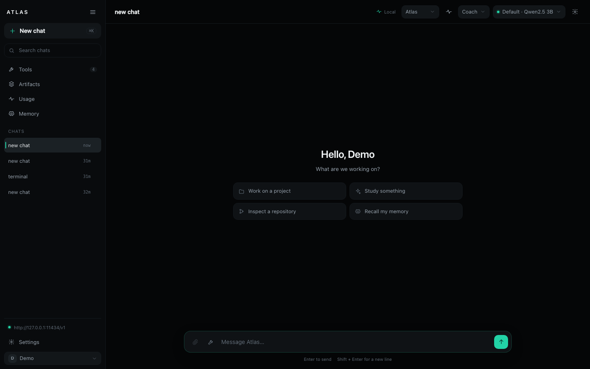
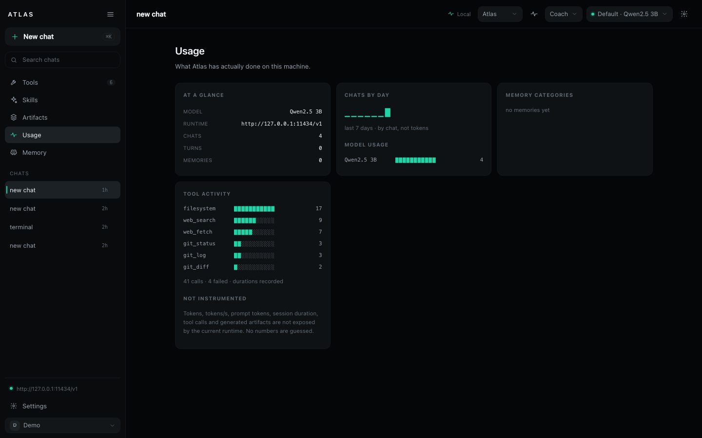
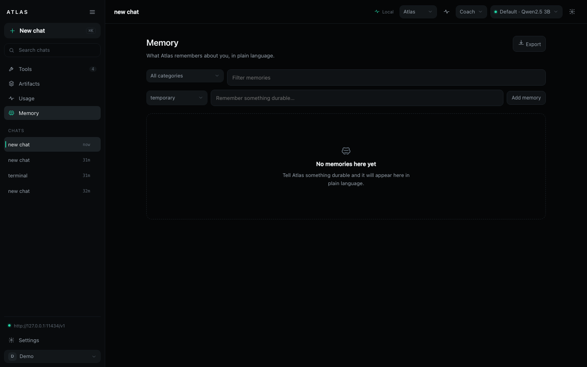
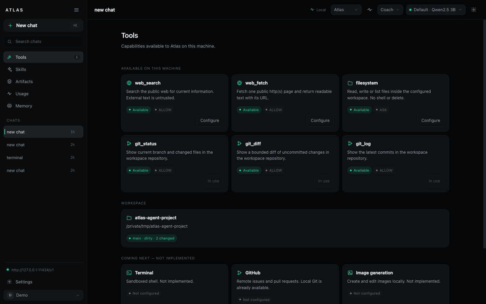
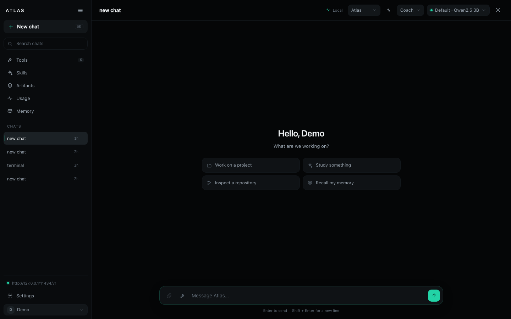
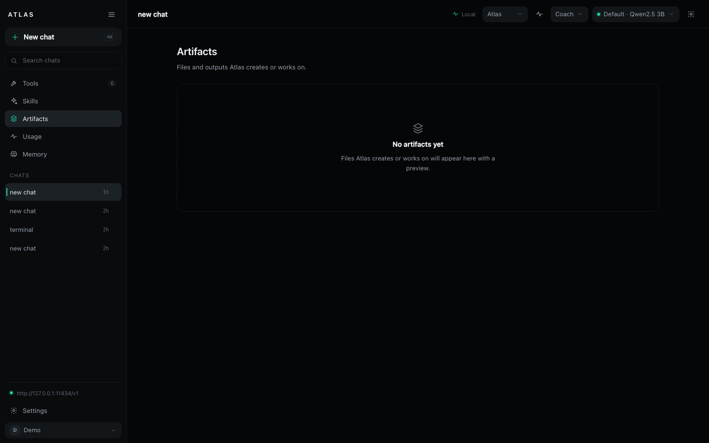
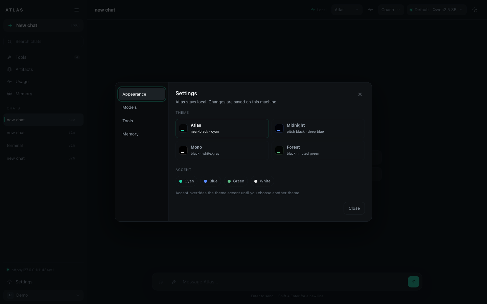

# Atlas

**A local AI mentor that actually remembers you — running on your own laptop, no account, no cloud, $0/month.**

[]()
[]()
[]()
[]()
[]()
[]()
[]()
[]()
[]()

```
you> I'm a first-year CS student, 8 GB M1, learning Python and C.
     · noted -> notes/the-user-is-learning-python-and-c.md

you> /quit
$ atlas
you> what do you know about me?

atlas> First-year CS student on an 8 GB M1, learning Python and C.
       You prefer short answers. You own a Windows laptop with a 2060.
```

Every other assistant forgets you when the tab closes. Atlas writes to plain
Markdown files, retrieves the relevant ones next time, and never sends them
anywhere.

---

## Screenshots

| | | |
|---|---|---|
|  |  |  |
| Near-black chat &amp; welcome | Real usage data | Plain-language memory |

| | |
|---|---|
|  |  |
| Tool workspace | Lazy-loaded skills |

| | |
|---|---|
|  |  |
| Real artifacts with previews | Themes, models, tools, memory |

---

## Demo

<!-- Record it: see docs/README.md, then uncomment.

-->

```console
$ atlas
atlas · life + habits + focus. Keeps you honest.
      · qwen2.5:7b on remote GPU @ http://your-gpu-host:11434/v1 · 18 notes

[coach]> I'm behind on my C assignment and I keep avoiding it.

atlas> What's the first 10 minutes of it look like — not the whole
       assignment, just the part you're avoiding.

[coach]> probably just setting up the toolchain again

atlas> Then that's today's task. Setup only. Nothing else.
       You avoided it because it's boring, not because it's hard.

[coach]> /quit
```

Two diagrams and the design reasoning: **[docs/architecture.md](docs/architecture.md)**.

---

## Why another AI assistant?

Because the interesting problem isn't the model. It's **memory you can trust.**

| | Atlas | Hosted assistants |
|---|---|---|
| Cost | $0 forever | subscription / per-token |
| Offline | yes | no |
| Your memory | files in `notes/` you can edit and delete | vendor's database |
| Who can read it | you | the vendor |
| Behaviour changes when | *you* edit the code | *they* ship an update |
| Model quality | 3B–7B local | frontier |

Atlas is not smarter than Claude. It's **yours** — and it can't be repriced,
shut down, or trained on your data.

---

## Features

- **Persistent memory** in plain Markdown. One fact per file. Delete a wrong
  one with `rm`.
- **Obsidian-ready vaults.** Point `ATLAS_VAULT` at your vault; Atlas only
  manages `Atlas/Memory/`. See **[the Obsidian guide](docs/obsidian.md)**.
- **Two-pass memory writes.** A chat call plus a cheap JSON "librarian" pass,
  because small models only call tools correctly ~50% of the time.
- **Three guards against invented memories.** No guesses, no meta-facts, no
  ungrounded notes. This is the part most personal-AI projects get wrong.
- **Semantic recall** via `nomic-embed-text`, with keyword fallback that works
  on a plane.
- **Five modes**: `coach`, `tutor`, `review`, `debug`, `plan`.
- **Activity awareness**: reads your `git log` and edited files. No screenshots,
  no keylogger, no cloud.
- **Runs on 8 GB of RAM.** Or offload the model to a gaming laptop over Wi-Fi.
- **Swappable models.** Ollama, llama.cpp, vLLM, LM Studio, or another
  OpenAI-compatible endpoint. See **[custom models and speed](docs/custom-models.md)**.
- **~1,000 lines of Python.** No frameworks. You can read all of it.

---

## Quickstart

```bash
git clone https://github.com/lewodro/atlas && cd atlas
./install.sh          # uv + ollama + model + verify (~5 min)
atlas                 # talk to it
```

Requirements: Python 3.12+, [uv](https://docs.astral.sh/uv/), and
[Ollama](https://ollama.com) — or let the installer fetch a portable copy:

```bash
./install.sh --vendored    # no Homebrew, everything inside ./vendor
```

Verify:

```bash
uv run python check.py        # 7 checks
uv run python eval/run_eval.py  # 5/5 = memory works
```

---

## Web UI

Same harness, same memory, saved sessions. Browser optional. On first launch
Atlas finds your running Ollama, LM Studio, llama.cpp or vLLM server by itself
— click ⚙ to switch runtimes and models without editing files.

The interface is a quiet workspace: a compact sidebar with chats, Tools,
Artifacts and Memory; a single rounded composer; custom keyboard-accessible
controls for mode, model and profile. Cyan is reserved for active state,
local model status and running tools. No native dropdowns, no dashboard clutter.

**Tools** shows what is genuinely available on this machine and clearly marks
everything else as *not configured* — web search, filesystem, terminal, Git,
image generation and MCP servers have UI surfaces ready, but are not
implemented yet. **Artifacts** is an empty list with preview components ready
for real files. **Usage** shows only real counts from the local API, with
terminal-style text charts and an optional floating panel. **Memory** presents
durable facts as plain statements grouped into About you / Preferences /
Projects / Goals / Environment.

The default theme is near-black with a small cyan accent. Settings offers
Atlas (cyan), Midnight (deep blue), Mono (white/gray) and Forest (muted green),
plus a custom accent. Themes change backgrounds, surfaces, borders and text,
not just the accent color. Everything is stored in the browser's local
storage — no account, no sync.

---

## Interface architecture

```
web/index.html      semantic shell, one inline SVG icon set
web/style.css       design tokens, surfaces, components, responsive rules
web/app.js          state, custom dropdowns, SSE streaming, views, memory UI
```

No framework, no build step, no bundled assets. The frontend speaks only to
the existing `/api/*` routes; adding a real tool later means filling an
already-designed card, not redesigning the shell.

```bash
uv run python server.py     # http://localhost:7777
atlas web                   # starts the server and opens it
```

Running `main.py` interactively also asks whether to open the Web GUI. Choose
`yes` once, or use `atlas web` as the shortcut next time. An auto-opened server
stops a few seconds after its browser tab closes, so localhost is not left
behind. Use `uv run python server.py --stay-open` only when you deliberately
want a server that survives browser tabs and stops with `Ctrl+C`.

<!--  -->

One stdlib HTTP server, one HTML file, vanilla JS, no build step. Streams
tokens over SSE, keeps every chat in SQLite, shows notes/chats/turns in the
sidebar.

`⌘K` new chat · `↵` send · `⇧↵` newline · `esc` stop · double-click a title
to rename.

---

## Working tools

Three tools are live in chat and on the CLI. See **[docs/tools.md](docs/tools.md)** for the security model.

| Tool | What it does | CLI |
|---|---|---|
| Web search | DuckDuckGo results, no key (Brave optional) | `atlas net search "query"` |
| Web fetch | Readable text from a public page, with source URL | `atlas net fetch https://…` |
| Filesystem | Read / write / list inside one chosen workspace | `atlas fs read path` |

Network calls are pinned to public IPs with SSRF checks on every redirect. Filesystem access is confined to an explicit workspace; hidden files, keys, symlinks and path traversal are refused. Tool output is treated as untrusted data, never as instructions.

```bash
atlas tools                              # status of every tool
atlas tools configure --workspace ~/dev/project
atlas net search "Python lists tutorial" --limit 3
atlas net fetch https://example.com
printf 'hello' | atlas fs write notes/hello.txt
atlas fs read notes/hello.txt
uv run python -m unittest discover -s tests -v   # 33 offline tests
```

---

## Agent runtime

Atlas now runs a bounded agent loop: select a skill, call tools, inspect
results, call more tools, answer. Skills are instruction files in
`skills/<id>/SKILL.md`, loaded only when needed. Tools are declared in one
registry that drives the model, CLI, API and GUI. Writes require an explicit
Allow; DENY tools are never advertised. See **[docs/agent.md](docs/agent.md)**.

```bash
atlas tools                              # registry-driven tool list + permissions
atlas tools permissions
atlas skills list | show web-research
atlas artifacts list
atlas workspace                          # root, repo, branch, clean/dirty
```

---

## How memory works

```
your message
   ├─▶ chat(messages, tools)      answers you; may call remember()
   └─▶ librarian(message)         JSON: "what is durable here?"   (guaranteed)
             │
             ▼  3 guards: stated · not meta · grounded in your words
        notes/*.md  ← human-readable, editable, one fact each
             │
             ▼  consolidate.py (nightly)
        notes/_digest.md  ← compressed, always in context
```

Why two calls? A 3B model calls tools reliably about half the time. If memory
depended on it *choosing* to save something, facts would vanish silently.

Why guards? Without them a small model writes *"the user wants to learn about
pointers"* into permanent memory — and then believes it forever.

Generated files start with `_` and are excluded from recall. **Inference never
becomes memory.**

For an explicit write, without model extraction:

```bash
atlas remember "I am learning Rust."
```

---

## Modes

| Mode | Use it when |
|---|---|
| `coach` | you need to be honest about how the week went |
| `tutor` | learning something and want to be quizzed, not lectured at |
| `review` | Sunday: what the commits say vs. what you say |
| `debug` | stuck; hypotheses before fixes |
| `plan` | the week has no shape |

```
atlas tutor          # switch hat
/mode debug          # or mid-conversation
/frontier            # optional: send just this question to a paid model
```

---

## Use a GPU on your LAN (optional)

Better answers, same memory:

```powershell
# Windows laptop with an RTX 2060
.\install.ps1        # portable ollama, LAN bind, firewall, model
```

It prints one line for the client's `.env`:

```ini
ATLAS_BASE_URL=http://your-gpu-host:11434/v1
ATLAS_MODEL=qwen2.5:7b
```

Mac stays the brain, GPU becomes the muscle. Laptop asleep? Falls back to the
local 3B.

---

## Benchmarks

Measured on an 8 GB M1 with `qwen2.5:3b`, not estimated:

| measurement | result |
|---|---|
| tool call, native JSON | 12/16 · 75% |
| tool call, usable after salvage | 12/16 · 75% |
| retrieval recall@5 | 5/5 |
| latency, median | 2.14 s |

Reproduce on your own hardware, or compare a different model:

```bash
atlas bench
atlas bench --model qwen2.5:7b --out docs/bench-7b.json
```

The 3-in-4 failure rate is why `main.py` has a deterministic extraction pass
and `librarian.py` has guards. Full output: `docs/bench.json`.

---

## Profiles and memory

Atlas keeps memory per local profile, never in the model weights. Switching
models never changes what you remember; switching profiles isolates it.

```bash
atlas user list
atlas user create "Friend"          # returns an id
atlas user switch u-xxxxxxxx
atlas memory list                   # 0 for a fresh profile
atlas memory search "tennis ranking"
atlas memory add projects "Side project: grid renderer in C"
atlas memory correct 19 "Updated fact"
atlas memory forget 19
atlas memory import                 # loads notes/*-seed-*.md into this profile
atlas memory export                 # JSON, all your data
atlas memory clear --yes
```

In the web UI the profile selector sits above the stats in the sidebar; the
**mem** button opens the memory inspector, where you can add, filter and
forget facts. When a reply uses stored context, the chat shows a small
"used N saved memories" line. Secrets (keys, passwords, tokens, `.env`) are
rejected before they can be stored, and an empty profile gets a deterministic
"I don't have that saved" instead of a guessed identity.

Full design and schema: `docs/memory.md`.

---

## Bring your own model

Atlas talks to anything that speaks the OpenAI chat-completions API: Ollama,
LM Studio, llama.cpp, vLLM, OpenRouter, or a GPU box on your LAN.

```bash
atlas models                                  # detected runtimes + installed models
atlas models --runtime lmstudio               # point at LM Studio's default port
atlas use qwen2.5:7b                          # switch the default
atlas models --endpoint http://127.0.0.1:1234/v1 --use local-model
atlas models --pull qwen2.5:7b                # download with Ollama
```

Or click **⚙** in the web UI to set the endpoint, key, and model, and use the
**model dropdown** to pick a model per chat. No restart needed — choices live
in `data/settings.json`, not in the code. Embedding models are hidden from the
picker.

---

## Six-month program

`training/` contains a 26-week plan for turning the vault into a model of you:
daily prompts, weekly reviews, prediction scoring, and a 20-question eval.
No fine-tuning — just better memory.

Start with [`training/README.md`](training/README.md).

---

## FAQ

**Does it send my data anywhere?** Not by default. Ollama is local, memory is
local. Only if you configure a frontier provider.

**Will it run on 8 GB?** Yes — that's the target machine. A 3B model plus
embeddings fits comfortably.

**Can I use my own model?** Yes. Set `ATLAS_BASE_URL`, `ATLAS_API_KEY`, and
`ATLAS_MODEL`. Atlas keeps the same Markdown memory when the model changes.

**Is this a fine-tune?** No. Memory, not weights. That's why swapping models
doesn't lose your history.

**Why not LangChain?** You can't debug a harness you didn't write.

**Is it production-ready?** No. It's a single-user tool that you maintain.
That's the trade for owning it.

---

## Privacy

`notes/` and `data/` are gitignored. **This repo ships code, not memories.**
If you fork it, keep your vault private.

## License

MIT. Take it, change it, ship it.
