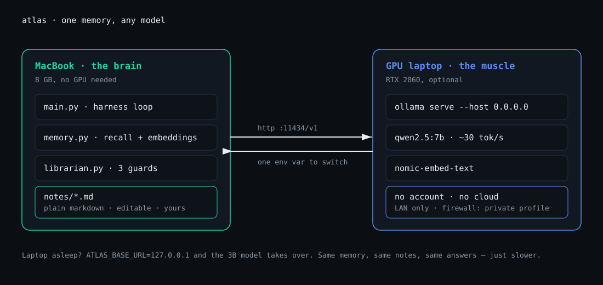
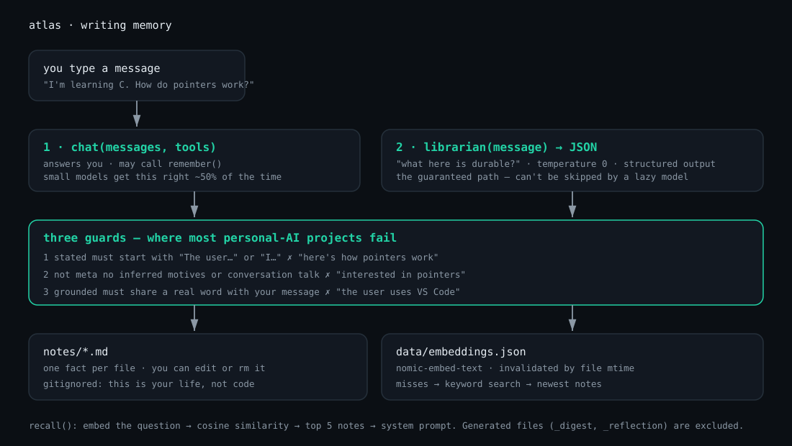

# Architecture

Two diagrams and the reasoning behind them. If you read only one thing,
read [§3](#3-the-three-guards) — it's the part that decides whether the memory
is trustworthy.

---

## 1. Where it runs



The harness holds the memory and is small enough to run anywhere. The model
is stateless and swappable. That split is why the same vault works with a 3B
model on the laptop, a 7B on the LAN, or a frontier model for one question.

Switching tiers is one line in `.env` — the code doesn't know or care:

```ini
ATLAS_BASE_URL=http://your-gpu-host:11434/v1   # the 2060
ATLAS_MODEL=qwen2.5:7b
```

If the GPU box is asleep, `/frontier` or a fallback `.env` takes over. Same
notes, same answers, different latency.

---

## 2. How memory is written



Every turn makes **two** model calls:

| Call | Purpose | Reliability |
|---|---|---|
| `chat(messages, tools)` | answer you; *may* call `remember()` | ~50% on a 3B model |
| `librarian(message)` | JSON "what is durable here?" | ~100% (constrained output) |

The second call exists because the first is unreliable. A harness that only
trusts tool calls loses facts silently — and you never find out.

---

## 3. The three guards

Between the model and `notes/`, every candidate fact must pass:

```
1. stated    starts with "The user…" / "I…"        rejects instructions and answers
2. not meta  no "asked", "interested", "wants"      rejects conversation commentary
3. grounded  shares a real word with your message   rejects inventions
```

Without them, a 3B model will write this into permanent memory:

> "The user wants to know how to create a virtual environment."

That is not a fact about you. It is a fact about the last thirty seconds. Six
months of that and the vault is noise — which is why most personal-AI demos
feel impressive for a week and useless by month two.

---

## 4. Retrieval

```
question ──▶ embed (nomic-embed-text)
              │
              ├── cosine similarity over cached note vectors
              ├── no embedding model?  → keyword match (Jaccard-ish)
              └── nothing matched?     → newest 3 notes
                        │
                        ▼
              top-k notes → system prompt
```

Deliberately three layers. Each one fails differently, and the ugly fallback
is what makes "what do you know about me?" work before you've written
fifty notes.

The cache (`data/embeddings.json`) is invalidated by file mtime, so editing a
note by hand re-embeds exactly that note — never the whole vault.

---

## 5. What is deliberately *not* here

| Not included | Because |
|---|---|
| LangChain / LlamaIndex | you can't debug a harness you didn't write |
| A vector database | 200 notes fit in a JSON file |
| Fine-tuning | memory beats weights, and survives a model swap |
| A web UI | the terminal is the interface; a UI is a second product |
| Auth / multi-user | it's your laptop, not a service |

Each of those is a real choice you can reverse later — the memory format
doesn't depend on any of them.
